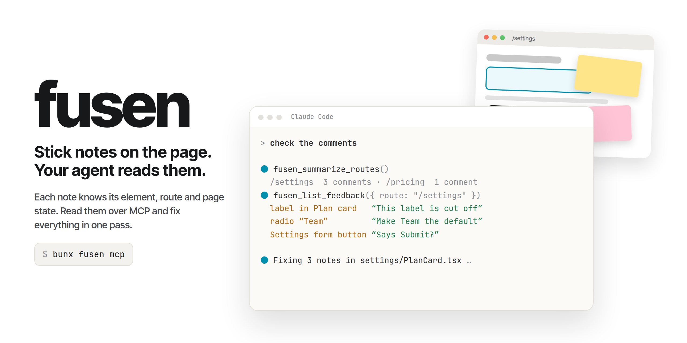
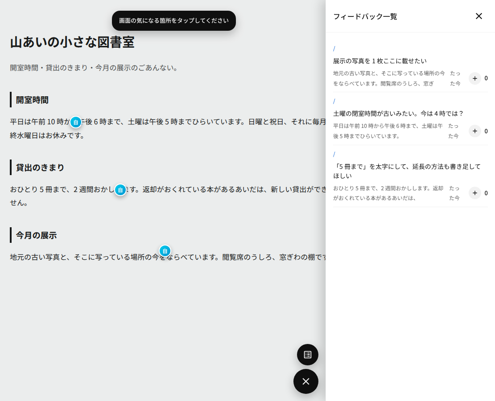

# fusen

[English](./README.md) | 日本語

**どの Web ページにも貼れる付箋。AI エージェントが読むために作った。**

ページの要素を選んで付箋を貼り、何を変えてほしいかを書く。付箋はその要素にくっついたまま
残る。あとで AI コーディングエージェントが全部の付箋を読む — どこに貼られ、何が書かれ、
そのときページがどう見えていたか — そして一度にまとめてページを直す。

fusen は Web Component 1つ、`<fusen-widget>` だ。`<script>` タグ1本で、フレームワークを
問わずどのサイトにも載る。[WebMCP](https://webmachinelearning.github.io/webmcp/) に対応して
いるので、ページ自身が付箋をエージェントに渡せる。



## 目次

- [なぜ fusen か](#なぜ-fusen-か)
- [エージェントのループにどう組み込むか](#エージェントのループにどう組み込むか)
- [使いどころ](#使いどころ)
- [クイックスタート](#クイックスタート)
- [lite かサーバー版か](#lite-かサーバー版か)
- [エージェントが付箋を読む経路](#エージェントが付箋を読む経路)
- [Claude Code プラグイン](#claude-code-プラグイン)
- [パッケージの中身](#パッケージの中身)
- [安全のための設計](#安全のための設計)
- [ガイド](#ガイド)
- [コントリビュート、ライセンス、セキュリティ](#コントリビュートライセンスセキュリティ)

## なぜ fusen か

AI に「ボタンを直して」と言ったりスクリーンショットを貼ったりしても、**どの**ボタンの
ことか AI は推測するしかない。fusen はその推測をなくす。

- **ピンポイント。** 付箋は選んだ要素に結び付く。ピクセル位置や文章ではない。エージェントは
  その要素、ルート、そして付箋を書いた瞬間のページ状態のスナップショットを受け取る。
- **付箋は溜まり、誰も待たない。** 誰でも好きなときに付箋を貼れる — 自分でも、チームの人
  でも、クライアントでも。フィードバックは非同期に溜まるので、大勢で1つのページを見て、
  修正はまとめて一度に行える。
- **エージェントは好きなときに拾う。** 付箋を書いても AI は起動しない。エージェントは自分の
  都合で溜まった付箋を読む — 頼まれたときでも、ループで10分おきでも — 100枚でも1枚と同じ
  ように扱える。付箋ごとのモデル呼び出しは無い。安く済み、作業はまとまって届く。
- **どこでも動く。** 独自の Shadow DOM を持つ標準の Web Component だ。React、Vue、素の
  HTML、サーバーレンダリングのアプリ — タグを置けば動く。ホスト側のページにビルド工程は
  要らない。
- **軽い。** lite バンドルは依存込みで全部で約 170 KB（gzip で約 50 KB）。
- **WebMCP 内蔵。** 属性1つで、ページがブラウザエージェント向けに読み取り専用の道具を登録
  する。WebMCP に対応したライブラリは今のところ少ない。

付箋とエージェントとループをどう組み合わせるかは自由だ — 部品は小さく組み合わせやすい。
自分なりの使い方を見つけるのも楽しみのうちだ。

## エージェントのループにどう組み込むか

作者は毎日こう使っている。

1. 作っているアプリに fusen を載せる（サーバー版。チーム全員の付箋が1か所に集まる）。
2. アプリを使いながら付箋を貼る。「このラベルが切れている」「これを既定にして」。
3. エージェントのループが10分おきに起き、新しい付箋を読み、同じコードに関わるものを
   まとめて直す。
4. 修正が出て、付箋は解決済みになる。誰もエージェントを手で起動していないし、一気に50枚
   貼られても実行は50回ではなく1回で済む。

ループそのものは自分で用意する — cron ジョブでも systemd タイマーでも Claude Code の
セッションでもよい。fusen がやるのは付箋を読めるようにすることだけで、それは
[エージェントが付箋を読む経路](#エージェントが付箋を読む経路) のどれかで行う。

## 使いどころ

| やりたいこと                                                      | 使うもの                                              |
| ----------------------------------------------------------------- | ----------------------------------------------------- |
| AI が作ったプロトタイプの気になる所を指して「ここを直して」と言う | **script タグ1本（lite）**                            |
| ステージング環境のフィードバックをチームやクライアントから集める  | **サーバー版**                                        |
| 報告された問題をエージェントに直し続けてもらう                    | **サーバー版 + エージェントのループ**                 |
| 開発中の自分のビルドにメモを付け、ブラウザエージェントから読む    | **lite + WebMCP**                                     |
| 「コメント見て」と言ったら Claude Code に付箋を読ませる           | **[Claude Code プラグイン](#claude-code-プラグイン)** |

## クイックスタート

### AI に入れてもらう

**[INSTALL.ja.md](./INSTALL.ja.md)** のプロンプトをコピーして、コーディングエージェント
（Claude Code、Codex、Cursor など）に貼る。エージェントがプロジェクトを調べ、fusen を
入れ、プラグインをつなぎ、付箋が再読み込み後も残ることを確かめる。

### script タグ1本

ちょっとした作業 — 概念実証、AI が生成したサイト、開発中の自分のビルド — ならこれで足りる。

```html
<script type="module" src="https://cdn.jsdelivr.net/npm/fusenjs/dist/fusen-lite.js"></script>
<fusen-widget route="/"></fusen-widget>
```

隅にバッジが出る。押して要素を選び、付箋を書く。付箋はブラウザ（IndexedDB）に保存される
ので、サーバーもデータベースもビルド工程も要らない。付箋の保存先は差し替えられるので、
別の場所に置くこともできる（[lite ガイド](./docs/ja/guide/lite.md#保存先は差し替えられる)）。

次のどれかが要るのでなければ、これを選べばよい。

- 他の人が付箋を見たり足したりする
- 複数のマシンやブラウザで同じ付箋を使う
- 付箋をサーバーに保存する

要るならサーバー版を使う — ウィジェットは同じで、付箋の保存先が変わるだけだ。

### Bun で入れる

```sh
bun add fusenjs
```

```sh
bunx fusenjs serve --db ./fusen.sqlite --port 8400   # the server, as its own process
bunx fusenjs mcp                                     # an MCP server for your agent
```

サポートするランタイムは Bun。`fusen serve` と `fusen mcp` は Bun で動く。`fusenjs/server` の
ハンドラ自体は Web 標準の `Request` → `Response` なので、Deno・Node 18+・Workers にも
マウントできる（[サーバーガイド](./docs/ja/guide/server.md)）。

### 日本語で表示する

ウィジェットの文言は既定で英語。日本語にするには、要素の `labels` プロパティに次の対応表を
渡す（一部だけ渡せば、残りは英語の既定のまま）。script タグ1本でも `fusenjs/ui` でも同じ。

```html
<script type="module">
  document.querySelector("fusen-widget").labels = {
    openPanel: "フィードバック一覧を開く",
    startMode: "フィードバックモードを開始",
    endMode: "フィードバックモードを終了",
    pickHint: "画面の気になる箇所をタップしてください",
    composerPlaceholder: "気になった点やご要望を入力してください",
    composerCancel: "キャンセル",
    composerSubmit: "投稿",
    composerError: "送信できませんでした",
    composerRetry: "再試行",
    panelTitle: "フィードバック一覧",
    panelEmpty: "まだフィードバックはありません",
    close: "閉じる",
    itemFocusHint: "この指摘が付いた場所を表示",
    focusNotFound: "この指摘の場所は今のページで見つかりませんでした",
    sent: "送信しました",
    deleteItem: "この指摘を取り消す",
    deleteConfirmHint: "本当に取り消しますか、もう一度タップで確定",
    deleteConfirmText: "取り消す?",
    pinCluster: (n, d) => `${n}件のコメント: ${d}`,
    formatRelativeTime: (iso) => {
      const s = Math.max(0, (Date.now() - new Date(iso).getTime()) / 1000);
      if (s < 60) return "たった今";
      if (s < 3600) return `${Math.floor(s / 60)}分前`;
      if (s < 86400) return `${Math.floor(s / 3600)}時間前`;
      if (s < 86400 * 30) return `${Math.floor(s / 86400)}日前`;
      const d = new Date(iso);
      return `${d.getFullYear()}/${d.getMonth() + 1}/${d.getDate()}`;
    },
  };
</script>
```

投稿者の既定名（サーバーの匿名 `Anonymous` と `Guest-xxxx`、lite の `You`）は `labels` では変わらない。
日本語名にしたいときは、サーバーなら `resolveAuthor`、lite なら `createFusenLite({ identity })` に名前を渡す（`fusenjs/lite` を自分で組むとき。script タグ1本の版では変えられない）。
lite で既に使っていたブラウザは、保存済みの名前（以前の既定なら `自分`）をそのまま使い続ける。

## lite かサーバー版か

|                      | lite                                | サーバー版                                 |
| -------------------- | ----------------------------------- | ------------------------------------------ |
| 付箋の保存先         | ブラウザ（IndexedDB）               | 自分のサーバー + SQLite か自前の DB        |
| 用意するもの         | **無し**                            | サーバープロセス1つ（またはルート1つ）     |
| 付箋が見える人       | **自分だけ、このブラウザだけ**      | ページを開いた人全員                       |
| エージェントの読み方 | WebMCP、または CDP 経由でページから | HTTP 上の MCP、または HTTP API             |
| 向いている用途       | 1人での作業、プロトタイプ           | チームレビュー、クライアントの意見、ループ |

**lite では**付箋を誰かと共有することも、別のマシンや別のブラウザプロファイルに持ち出す
ことも、そのブラウザ以外に保存することも**できない**。どれかが必要ならサーバー版を使う。
あとからの切り替えはスクリプト1本の差し替えで済むが、保存済みの付箋は両者の間で移らない。

両方を含んだ1本のバンドル `fusen.js` もある。`data-mode="client"` で lite になる。
詳しくは [lite ガイド](./docs/ja/guide/lite.md) · [サーバーガイド](./docs/ja/guide/server.md)。

## エージェントが付箋を読む経路

| 経路                                | 必要なもの                                                   | 向いている相手                      |
| ----------------------------------- | ------------------------------------------------------------ | ----------------------------------- |
| **WebMCP**（`data-webmcp`）— 実験的 | WebMCP フラグかオリジントライアルが有効な Chrome。ポート不要 | ブラウザの中で動くエージェント      |
| CDP 経由の **`window.__fusen`**     | デバッグポート付きで起動したブラウザ                         | スクリプト、Playwright、lite        |
| **MCP** — `bunx fusenjs mcp`        | サーバーの URL（`FUSEN_BASE_URL`）、lite なら CDP            | Claude Code などの MCP クライアント |
| **HTTP API**                        | サーバー                                                     | 自作のツールやループ                |
| **Claude Code プラグイン**          | このリポジトリの clone                                       | Claude Code での「コメント見て」    |

エージェント向けの経路（WebMCP・CDP・MCP）は既定で**読み取り専用**。HTTP API はサーバーの
読み書きのプロトコルそのもの。WebMCP は Chrome ではまだオリジントライアルなので、
プレビューとして扱うこと。他の経路は WebMCP に依存しない。どのエージェントにどの経路が
一番安全かを含め、詳しくは [エージェントガイド](./docs/ja/guide/agents.md)。

## Claude Code プラグイン

このリポジトリはプラグインでもある。Claude Code と、
[Agent Plugins 1.0.0](https://agent-plugins.org/) に従うクライアントで使える。

```sh
git clone https://github.com/chokolademilch7/fusen && (cd fusen && bun install)
claude --plugin-dir ./fusen
```

- `fusen-comments` スキル — 付箋の読み方。サーバー版なら MCP、lite ならブラウザを選ぶ
- `fusen-triage` エージェント — 付箋を場所付きの作業リストに変える
- `fusen` MCP サーバー — `FUSEN_BASE_URL` が設定されていればサーバーを読む

lite にはサーバーが無いので、MCP サーバーはデバッグポート付きで起動したブラウザを通して
ページから付箋を読む。そのブラウザが動いていなければ、そう答えて起動のしかたを案内する。

## パッケージの中身

npm パッケージは `fusenjs` 1つで、部品ごとにエントリポイントがある。

| インポート          | 中身                                                                                                                                              |
| ------------------- | ------------------------------------------------------------------------------------------------------------------------------------------------- |
| `fusenjs/ui`        | カスタム要素 `<fusen-widget>`（open な Shadow DOM）                                                                                               |
| `fusenjs/lite`      | ウィジェット用の IndexedDB + BroadcastChannel の保存先（`createFusenLite`）。`fusenjs/ui` と組み合わせるか、すぐ使えるタグは `dist/fusen-lite.js` |
| `fusenjs/server`    | プロトコルを `Request` → `Response` の関数1本にしたもの。4メソッドのストアを自分で用意する（同梱の SQLite 版でもよい）                            |
| `fusenjs/mcp`       | 付箋を道具として公開する MCP サーバー。書き込みを許可しない限り読み取り専用                                                                       |
| `fusenjs/core`      | 依存ゼロの TypeScript。要素のアンカリング、ページのスナップショット、エージェント向けのクエリ                                                     |
| `fusenjs/dist/*.js` | 自己完結した script タグ用バンドル。`fusen-lite.js`、`fusen.js`                                                                                   |

ウィジェットは SolidJS と XState で書かれていて、どちらも中に同梱している — ページ側に
どちらも要らないし、使う API に出てくることもない。

## 安全のための設計

- **エージェントからは既定で読み取り専用。** WebMCP には書き込みの道具が無い。MCP サーバーが
  投票・削除の道具を足すのは `FUSEN_ALLOW_WRITE=1` を設定したときだけ。
- **付箋の本文は信用しないものとして扱う。** 付箋は人が書いた自由文で、そのままエージェントの
  コンテキストに入る。だから道具は文章ではなく構造化 JSON を返し、WebMCP の道具は出力に
  `untrustedContentHint` を付ける。付箋の本文は指示ではなくデータとして扱うよう、エージェント
  に伝えておくこと。
- WebMCP なら**ポートを開けなくてよい**。一方 CDP の経路はデバッグポートを開ける — 専用の
  ブラウザプロファイルで使うこと。
- **同一オリジンのみ。** サーバーは CORS ヘッダを返さない。アプリの中にマウントするか、
  リバースプロキシの後ろに置く。単体サーバーは指定しない限り `127.0.0.1` で待ち受ける。
- **消せるのは自分の付箋だけ。** 自前のログインが無ければ、ブラウザごとに匿名の `HttpOnly`
  クッキーで識別する。自分のセッションは `resolveAuthor` で差し込む。
- 書き込みのたび（本文、ルート、コンテキスト）に**サイズ上限**があり、巨大な付箋1枚で全員の
  ウィジェットが重くなることを防ぐ。

## ガイド

- [lite](./docs/ja/guide/lite.md) — サーバー無し版、ページの外から付箋を読む方法
- [サーバー](./docs/ja/guide/server.md) — 5つのルート、SQLite、単体プロセス + プロキシ、識別、上限
- [エージェント](./docs/ja/guide/agents.md) — WebMCP、CDP、MCP、プラグイン、どれを使うか
- [埋め込み](./docs/ja/guide/embedding.md) — 自分のアプリで `fusenjs/ui` を使う、プロパティとイベント
- [設計上の約束](./docs/ja/guide/design.md) — オーバーレイの振る舞いと公開している状態名
- [採用マップ](./docs/ja/adoption-map.md) — 判断の経緯

## コントリビュート、ライセンス、セキュリティ

- コントリビュート: [CONTRIBUTING.ja.md](./CONTRIBUTING.ja.md)
- ライセンス: [MIT](./LICENSE)。同梱しているサードパーティの告知: [THIRD_PARTY_NOTICES.md](./THIRD_PARTY_NOTICES.md)
- セキュリティ: 脆弱性は [SECURITY.md](./SECURITY.md) に書かれた方法で非公開に報告する
