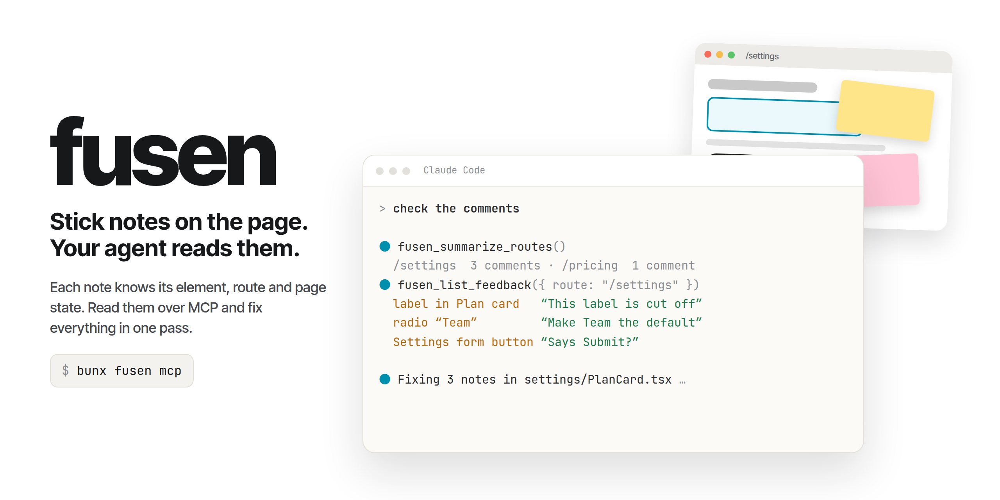
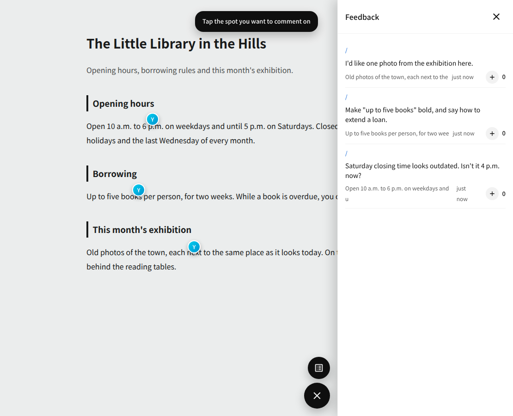

# fusen

English | [日本語](./README.ja.md)

**Sticky notes for any web page, made for AI agents to read.**

Pick an element on the page, stick a note on it, write what should change. The note stays
attached to that exact element. Later, your AI coding agent reads every note — where it is,
what it says, what the page looked like — and fixes the page in one go.

fusen is a single Web Component, `<fusen-widget>`. One `<script>` tag puts it on any site,
whatever the framework. It speaks [WebMCP](https://webmachinelearning.github.io/webmcp/),
so the page itself can hand the notes to an agent.



## Contents

- [Why fusen](#why-fusen)
- [How it fits an agent loop](#how-it-fits-an-agent-loop)
- [Use cases](#use-cases)
- [Quick start](#quick-start)
- [Lite or server](#lite-or-server)
- [How agents read the notes](#how-agents-read-the-notes)
- [Claude Code plugin](#claude-code-plugin)
- [What is in the package](#what-is-in-the-package)
- [Safe by design](#safe-by-design)
- [Guides](#guides)
- [Contributing, license, security](#contributing-license-security)

## Why fusen

Telling an AI "fix the button" or pasting a screenshot leaves it guessing **which** button
you mean. fusen removes the guessing.

- **Pinpoint.** Each note is anchored to the element you picked, not to a pixel or a
  sentence. The agent gets the element, the route, and a snapshot of the page state at the
  moment the note was written.
- **Notes pile up; nobody waits.** Anyone can stick notes whenever they like — you, a
  teammate, a client. Feedback accumulates asynchronously, so many people can review a page
  and the fixes happen in one batch.
- **Agents pick them up when they want.** Writing a note does not start an AI. The agent
  reads the pile on its own schedule — on demand, or every ten minutes in a loop — and
  handles a hundred notes as easily as one. No model call per note: cheaper, and the work
  arrives grouped.
- **Runs anywhere.** It is a standard Web Component with its own Shadow DOM. React, Vue,
  plain HTML, a server-rendered app — drop the tag in and it works. No build step for the
  host page.
- **Light.** The whole lite bundle, dependencies included, is about 170 KB (≈50 KB gzip).
- **WebMCP built in.** With one attribute the page registers read-only tools for browser
  agents. Few libraries ship WebMCP support today.

How you combine notes, agents and loops is up to you — the pieces are small and
composable, and finding your own workflow is part of the fun.

## How it fits an agent loop

This is how the author uses it every day:

1. fusen is on the app being built (server mode, so the whole team's notes land in one place).
2. People stick notes while using the app: "this label is cut off", "make this the default".
3. An agent loop wakes up every ten minutes, reads the new notes, groups the ones that touch
   the same code, and fixes them.
4. The fixes ship; the notes are resolved. Nobody had to start the agent by hand, and a
   burst of fifty notes costs one run, not fifty.

The loop itself is yours — a cron job, a systemd timer, a Claude Code session. fusen only
has to make the notes readable, which it does through any of the paths in
[How agents read the notes](#how-agents-read-the-notes).

## Use cases

| You want to…                                                               | Use                                           |
| -------------------------------------------------------------------------- | --------------------------------------------- |
| Point at parts of a prototype an AI built for you, then say "fix these"    | **One script tag (lite)**                     |
| Collect feedback on a staging site from teammates or a client              | **Server**                                    |
| Keep an agent fixing reported issues continuously                          | **Server + an agent loop**                    |
| Annotate your own dev build while you work, read it from the browser agent | **Lite + WebMCP**                             |
| Let Claude Code read the notes when you say "check the comments"           | **[Claude Code plugin](#claude-code-plugin)** |

## Quick start

### Let your AI set it up

Copy the prompt in **[INSTALL.md](./INSTALL.md)** and paste it into your coding agent
(Claude Code, Codex, Cursor, …). It inspects your project, adds fusen, wires up the
plugin, and checks that a note survives a reload.

### One script tag

For quick work — a proof of concept, a site an AI generated, your own dev build — this is
all you need:

```html
<script type="module" src="https://cdn.jsdelivr.net/npm/fusen/dist/fusen-lite.js"></script>
<fusen-widget route="/"></fusen-widget>
```

A badge appears in the corner. Click it, pick an element, write a note. Notes are kept in
your browser (IndexedDB), so there is no server, no database and no build step. Where
notes are stored is pluggable, so you can point them somewhere else
([Lite guide](./docs/guide/lite.md#the-storage-backend-is-pluggable)).

Pick this unless you need one of these:

- other people to see or add notes
- the same notes on more than one machine or browser
- notes kept on a server

Then use the server version — the widget is the same, only where notes are stored changes.

### Install with Bun

```sh
bun add fusen
```

```sh
bunx fusen serve --db ./fusen.sqlite --port 8400   # the server, as its own process
bunx fusen mcp                                     # an MCP server for your agent
```

Bun is the supported runtime: `fusen serve` and `fusen mcp` run on Bun. The `fusen/server`
handler itself is Web-standard `Request` → `Response`, so it also mounts in Deno, Node 18+
and Workers ([Server guide](./docs/guide/server.md)).

## Lite or server

|                 | Lite                          | Server                              |
| --------------- | ----------------------------- | ----------------------------------- |
| Notes stored in | your browser (IndexedDB)      | your server + SQLite or your DB     |
| You set up      | **nothing**                   | one server process (or one route)   |
| Who sees notes  | **only you, in this browser** | everyone who opens the page         |
| Agents read via | WebMCP, or the page over CDP  | MCP over HTTP, or the HTTP API      |
| Good for        | solo work, prototypes         | team review, client feedback, loops |

**Lite cannot** share notes with anyone, follow you to another machine or browser profile,
or keep notes anywhere but that browser. If any of that matters, use the server version.
Switching later is a change of one script, but saved notes do not move between the two.

There is also `fusen.js`, one bundle that contains both; `data-mode="client"` picks lite.
Details: [Lite guide](./docs/guide/lite.md) · [Server guide](./docs/guide/server.md).

## How agents read the notes

| Path                                      | Needs                                                | Best for                            |
| ----------------------------------------- | ---------------------------------------------------- | ----------------------------------- |
| **WebMCP** (`data-webmcp`) — experimental | Chrome with the WebMCP flag or origin trial; no port | an agent running inside the browser |
| **`window.__fusen`** over CDP             | a browser started with a debugging port              | scripts, Playwright, lite           |
| **MCP** — `bunx fusen mcp`                | the server URL (`FUSEN_BASE_URL`), or CDP for lite   | Claude Code and other MCP clients   |
| **HTTP API**                              | the server                                           | your own tools and loops            |
| **Claude Code plugin**                    | a clone of this repo                                 | "check the comments" in Claude Code |

Every agent-facing path (WebMCP, CDP, MCP) is **read-only** by default; the HTTP API is
the server's read/write protocol. WebMCP is still an origin trial in Chrome, so
treat it as a preview; the other paths do not depend on it. Details, including which path
is safest for which agent: [Agents guide](./docs/guide/agents.md).

## Claude Code plugin

This repository is also a plugin, for Claude Code and for clients that follow
[Agent Plugins 1.0.0](https://agent-plugins.org/).

```sh
git clone https://github.com/chokolademilch7/fusen && (cd fusen && bun install)
claude --plugin-dir ./fusen
```

- `fusen-comments` skill — how to read the notes; picks MCP for the server version and the
  browser for lite
- `fusen-triage` agent — turns notes into a work list with locations
- `fusen` MCP server — reads the server when `FUSEN_BASE_URL` is set

With lite there is no server, so the MCP server reads the notes from the page through a
browser started with a debugging port. If no such browser is running, it says so and
explains how to start one.

## What is in the package

One npm package, `fusen`, with entry points for each part:

| Import            | What it is                                                                                                                                 |
| ----------------- | ------------------------------------------------------------------------------------------------------------------------------------------ |
| `fusen/ui`        | the `<fusen-widget>` custom element (open Shadow DOM)                                                                                      |
| `fusen/lite`      | IndexedDB + BroadcastChannel storage for the widget (`createFusenLite`); use with `fusen/ui`, or `dist/fusen-lite.js` for a ready-made tag |
| `fusen/server`    | the protocol as one `Request` → `Response` function; you supply a 4-method store (or use the bundled SQLite one)                           |
| `fusen/mcp`       | an MCP server that exposes the notes as tools, read-only unless writes are allowed                                                         |
| `fusen/core`      | dependency-free TypeScript: element anchoring, page snapshots, the agent-facing queries                                                    |
| `fusen/dist/*.js` | self-contained script-tag bundles: `fusen-lite.js`, `fusen.js`                                                                             |

The widget is written with SolidJS and XState, and both are bundled inside it — your page
does not need either, and they never appear in the API you use.

## Safe by design

- **Read-only for agents by default.** No write tools over WebMCP; the MCP server only adds
  vote/delete tools when you set `FUSEN_ALLOW_WRITE=1`.
- **Note text is treated as untrusted.** Notes are free text from people and go straight
  into an agent's context, so the tools return structured JSON, not prose, and the WebMCP
  tools mark their output with `untrustedContentHint`. Tell your agent to treat note text
  as data, not instructions.
- **No open port needed** for WebMCP. The CDP path, by contrast, opens a debugging port —
  use a dedicated browser profile for it.
- **Same origin only.** The server sends no CORS headers; mount it in your app or behind your
  reverse proxy. The standalone server listens on `127.0.0.1` unless told otherwise.
- **You can only delete your own notes.** Without your own login, each browser gets an
  anonymous `HttpOnly` cookie identity. Plug in your session with `resolveAuthor`.
- **Size limits** on every write (body, route, context) keep one huge note from slowing
  everyone's widget.

## Guides

- [Lite](./docs/guide/lite.md) — the no-server version, reading notes from outside the page
- [Server](./docs/guide/server.md) — the five routes, SQLite, standalone process + proxy, identity, limits
- [Agents](./docs/guide/agents.md) — WebMCP, CDP, MCP, the plugin, and which to use
- [Embedding](./docs/guide/embedding.md) — using `fusen/ui` in your own app, properties and events
- [Design contracts](./docs/guide/design.md) — overlay behaviour and the public state names
- [Adoption map](./docs/adoption-map.md) — decision history

## Contributing, license, security

- Contributing: [CONTRIBUTING.md](./CONTRIBUTING.md)
- License: [MIT](./LICENSE). Bundled third-party notices: [THIRD_PARTY_NOTICES.md](./THIRD_PARTY_NOTICES.md)
- Security: report vulnerabilities privately as described in [SECURITY.md](./SECURITY.md)
